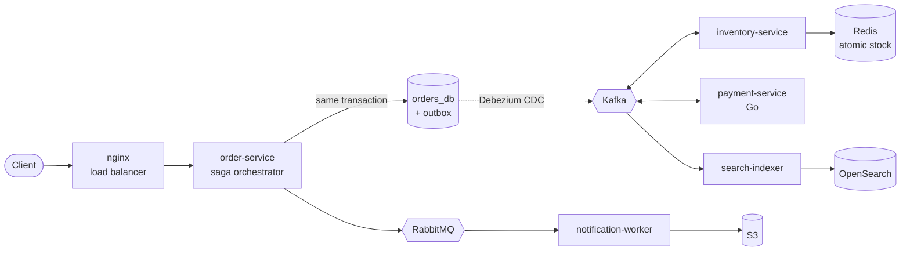

 

 

## 👋 About Me

Software Engineering undergraduate at **NSBM Green University**. I design and build systems **end to end**, from architecture and APIs to AI features and cloud deployment.

 

## 🎯 What I Do

<table>
<tr>
<td width="50%" valign="top">

### 🏗️ System Design
Distributed systems that stay correct under failure.

- Saga orchestration · Transactional outbox · CDC
- Idempotency · Retries · Dead-letter queues
- Caching · Rate limiting · Load balancing
- Cell-based isolation · Zero-trust identity

</td>
<td width="50%" valign="top">

### 💻 Full Stack
Secure, fast products from database to UI.

- REST APIs with **Spring Boot**, **FastAPI**, **Node.js**
- **React** frontends with React Query
- JWT · RBAC · OAuth · Multi-tenancy
- Indexing · N+1 fixes · Migrations

</td>
</tr>
<tr>
<td width="50%" valign="top">

### 🤖 AI Integration
LLM features you can trust in production.

- Local LLMs with **Ollama** + LLM APIs
- Rule-based findings, LLM-written summaries
- Output validation: every claim cites a source
- Workflow automation with **n8n**

</td>
<td width="50%" valign="top">

### ☁️ Cloud & DevOps
Infrastructure as code, monitored and automated.

- **AWS** with **CDK** + **Terraform**
- **Docker** · **GitHub Actions** CI/CD
- **Prometheus** · Alertmanager · **Loki**
- Load and chaos testing with **k6**

</td>
</tr>
</table>

 

## 🧰 Tech Stack

| | |
|:--:|:--|
| **Languages** |  |
| **Full Stack** |  |
| **Data & Messaging** |  |
| **Cloud & DevOps** |  |
| **AI & Automation** |    |

 

## 🧩 System Design Spotlight: OrderFlow

 

## 🚀 Featured Projects

<table>
<tr>
<td width="50%" valign="top">

### 📦 OrderFlow
 

**Event-driven order platform**, 5 services in Python + Go.

✅ Saga + outbox + idempotent consumers 
✅ Redis Lua atomic stock reservation 
✅ Load and chaos tested with k6

</td>
<td width="50%" valign="top">

### 🧾 Silverline
 

**Retail operations system** with admin, manager and POS apps.

✅ Spring Boot API + React frontend 
✅ JWT + RBAC, rate limiting, tracing 
✅ Indexing, caching, async processing

</td>
</tr>
<tr>
<td width="50%" valign="top">

### 🔎 HeadRef
 

**AI team insight tool** on GitHub + Jira data.

✅ Validated LLM pipeline with Ollama 
✅ Every claim linked to a real source 
✅ OAuth, multi-tenant, 550+ tests

</td>
<td width="50%" valign="top">

### 🏦 Arka
 

**Cell-isolated banking platform** · Duothan 6.0 buildathon.

✅ Per-Cell AWS VPCs with CDK + Terraform 
✅ Zero-trust service identity 
✅ Tamper-evident ledger audit

</td>
</tr>
<tr>
<td colspan="2" valign="top">

### 📟 AI-Powered DevOps Command Center
 

**Automated incident detection and recovery** · university group project.

✅ Prometheus + Loki alerts into n8n &nbsp;&nbsp; ✅ HMAC-signed recovery playbooks &nbsp;&nbsp; ✅ Fault injection + 52 tests

</td>
</tr>
</table>

 

## 📊 GitHub Stats

 

