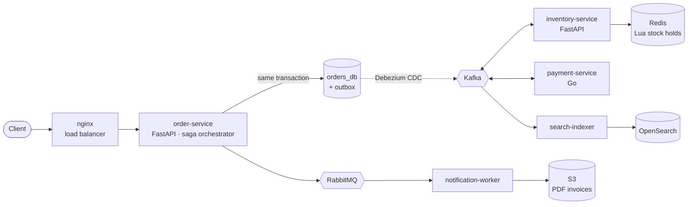

 

 

## About Me

I'm a Software Engineering undergraduate at **NSBM Green University** who builds software **end to end**: database schema, REST APIs, security, frontend, automated tests, containers and monitoring. Then I try to break it to see what holds.

My projects focus on what production systems actually need: **data that stays consistent when services fail**, **APIs that are secure by default**, and **performance changes backed by measurement**, not guesses.

- 🎯 Looking for **Software Engineering internships** (full-stack, backend or platform). Based in Sri Lanka, open to hybrid and remote
- ⚙️ Strongest in **Java + Spring Boot**, **Python + FastAPI** and **React**, with hands-on **Go**, **Kafka**, **Docker** and **Terraform**
- 🧠 Strong Java problem-solving from a competitive programming background

 

## What I Bring to a Team

| Capability | Where I've shown it |
|:--|:--|
| 🔁 **Ship features end to end** | **Silverline:** Flyway schema → Spring Boot API → JWT/RBAC → React UI → API and security tests |
| 🧱 **Keep data correct under failure** | **OrderFlow:** Saga with compensation, transactional outbox, idempotent consumers, retry and dead-letter topics |
| ⚡ **Improve performance with evidence** | **Silverline:** composite indexes, N+1 queries removed, database-level pagination, Caffeine caching, slow side effects moved to `@Async` |
| 🔐 **Build security in from the start** | JWT + RBAC, GitHub/Atlassian OAuth with multi-tenancy, HMAC-signed requests with replay protection, zero-trust workload identity |
| ✅ **Prove it works** | 550+ tests (HeadRef), 52 tests (DevOps Command Center), Spring test slices, k6 load tests and chaos testing (OrderFlow) |
| ☁️ **Deploy and observe it** | Docker, Terraform, AWS CDK, GitHub Actions, Prometheus, Alertmanager and Loki |
| 🤖 **Use AI responsibly** | **HeadRef:** rules produce every finding, the LLM only writes the summary, and a validator rejects any claim without a real source |

 

## Featured Projects

### 🧾 Silverline: Retail Operations Control System

A full-stack retail system with **admin, manager and POS interfaces** running on a secured Spring Boot API.

- **Business workflows:** built the Goods Received Note workflow that replaced the item-dispatch module, plus per-branch pricing and batch-level pricing with stackable promotions
- **Security:** JWT authentication and role-based access control with Spring Security, request rate limiting and request tracing
- **Performance:** composite indexes on high-traffic queries, removed N+1 queries with `@EntityGraph`, database-level pagination, and Caffeine caching for read-heavy reference data. Audit logging, email and WebSocket broadcasts run `@Async`, outside the request path
- **Frontend:** React admin, manager and POS apps built from feature-based modules with React Query
- **Quality:** schema changes managed with Flyway; Spring MVC and Spring Security test slices cover the REST API and RBAC rules

`Java` `Spring Boot` `Spring Security` `JWT` `PostgreSQL` `Flyway` `React` `React Query`

---

### 📦 OrderFlow: Event-Driven Order Platform · *personal project, ongoing*

Five services (Python and Go) that save an order, reserve stock, take payment and confirm it, or **undo every step** when something fails. It is built to stay correct when services crash, messages arrive twice or the payment provider is slow.

- **Saga orchestration:** the order service runs a state machine through stock reservation and payment, with compensation (stock release and refunds) when a step fails or times out
- **Reliable events:** a transactional outbox (Debezium to Kafka) means "data saved" and "event sent" can never disagree. Idempotent consumers, retry and dead-letter topics make duplicate events harmless, and an `Idempotency-Key` stops a retried request from creating a second order
- **Stock and payments:** atomic stock reservation with Redis Lua scripts, PostgreSQL for inventory persistence, payment service written in Go. Each service owns its own database
- **Measured, not assumed** ([raw results](https://github.com/keshan-dev/orderflow/tree/main/results/phase-1)):

| Test (k6) | Result |
|:--|:--|
| Search during a zero-downtime OpenSearch reindex | **7,032 requests, 0 failed**, p95 76.9 ms |
| Killing an API instance behind nginx | **6,175 requests, 0 failed** |
| Load + chaos round 1 (random service kills) | Found **2 consistency bugs**; fixes in progress |

`Python` `FastAPI` `Go` `PostgreSQL` `Kafka` `Debezium` `RabbitMQ` `Redis` `OpenSearch` `nginx` `Docker` `k6`

---

### 🔎 HeadRef: Evidence-Linked Team Insight Tool

Reads GitHub and Jira and tells a team lead **what each person is working on, what's blocking them and what's at risk**. Every statement links to the record it came from.

- **Data sync and linking:** FastAPI integration pulls data from GitHub and Jira, syncs it into PostgreSQL with Alembic migrations, and links Jira issues to their branches, pull requests and commits
- **Validated LLM pipeline:** deterministic rules produce every finding and a local Ollama model writes only the summary. A validator rejects unsupported claims, so each statement cites a real source record
- **Security:** GitHub App and Atlassian OAuth with multi-tenant workspaces, role-based access and read-only scopes
- **Testing:** 550+ tests, including checks that no secret ever reaches the model prompt

`Python` `FastAPI` `PostgreSQL` `SQLAlchemy` `Alembic` `Ollama` `OAuth` `GitHub Actions` `pytest`

---

### 🏦 Arka: Cell-Isolated Digital Banking Platform · *Duothan 6.0 buildathon*

A digital banking platform split into **isolated Cells that share no network path**, built by a team; my scope is below.

- **Zero-trust foundation:** shared service contracts, short-lived workload-identity authentication and the API gateway Cell Router, so every service-to-service call proves its identity
- **Identity and recovery:** identity service with multi-layered authentication, plus an operator Recovery Console with live Cell health, dual-approval quarantine and an audit trail
- **Ledger integrity:** hash-chained integrity audit with export, so tampering with the double-entry ledger is detectable
- **Infrastructure as code:** AWS CDK and Terraform for per-Cell VPCs

`TypeScript` `Node.js` `PostgreSQL` `Redis Streams` `AWS CDK` `Terraform` `GitHub Actions`

---

### 📟 AI-Powered Mobile DevOps Command Center · *university group project*

Detects incidents in running services and triggers **safe, automated recovery playbooks**.

- **Monitoring and alerting:** Prometheus, Alertmanager, Loki and Promtail stack with error-rate and service-down alerts (covered by rule unit tests), delivered to n8n through a token-protected webhook
- **Secure playbook executor:** Python service that runs restart and circuit-breaker playbooks only from HMAC-signed requests. It rejects replayed requests, runs each playbook at most once and acts only on allow-listed services
- **Fault injection and testing:** FastAPI sample service with metrics, JSON logs, switchable faults and a load generator for the end-to-end demo, plus 52 tests across the executor and sample app

`Python` `FastAPI` `Prometheus` `Alertmanager` `Loki` `Promtail` `n8n` `Docker` `pytest`

 

## Engineering Fundamentals

| Area | What I know | Applied in |
|:--|:--|:--|
| **Programming** | OOP, classes, interfaces, collections, exception handling | Spring Boot services in Silverline |
| **Data structures and algorithms** | Arrays, linked lists, stacks, queues, hash maps, searching, sorting | Competitive programming in Java |
| **Software design** | SOLID, dependency injection, Saga, transactional outbox, idempotent consumers | Silverline (Spring DI), OrderFlow |
| **APIs** | REST principles, request validation, authentication and authorization | Every project above |
| **Databases** | Relational design, joins, normalization, indexing, transactions, ACID; NoSQL with Redis and OpenSearch | Silverline indexing, OrderFlow outbox and Lua scripts |
| **Distributed systems** | Retries, timeouts, dead-letter queues, compensation, rate limiting, failover | OrderFlow |
| **Software quality** | Unit and integration testing, debugging, Git, CI/CD | HeadRef (550+ tests), Silverline test slices |

 

## Tech Stack

| | |
|:--|:--|
| **Languages** |   |
| **Backend** |     |
| **Frontend** |   |
| **Databases, Messaging and Search** |    |
| **Cloud, DevOps and Observability** |   |
| **AI and Automation** |    |
| **Testing** |    |

 

## Currently Building

- ☸️ **OrderFlow, next phase:** shipping it to Kubernetes with GitOps, and adding OpenTelemetry tracing with Prometheus, Loki, Jaeger and Grafana
- 🛠️ **After that:** a Kubernetes operator in Go, an eBPF runtime security agent, and running the full platform on AWS with Terraform
- 🤖 **AI engineering:** RAG pipelines, FastAPI services and n8n automation

 

## GitHub Stats

 

**Hiring a software engineering intern?** I'd be glad to talk: [justkeshan@gmail.com](mailto:justkeshan@gmail.com) · [LinkedIn](https://www.linkedin.com/in/shamika-keshan)

